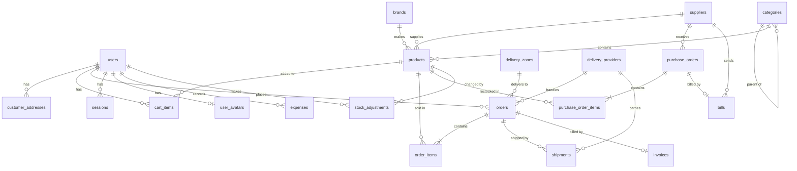

# CEC-Electronic — Database Design

Table design for the CEC-Electronic e-commerce app (Laravel). Built from the migrations in `database/migrations/`, with all later changes applied (money columns are already `DECIMAL(10,2)`). Checked against the real PostgreSQL database on 2026-11-10: 27 tables. Column types are written in general SQL form.

---

## 1. Overview

| Group | Tables |
|---|---|
| **Users & Auth** | `users`, `user_avatars`, `password_reset_tokens`, `sessions` |
| **Catalog** | `categories`, `brands`, `products` |
| **Shopping** | `customer_addresses`, `cart_items` |
| **Orders & Payment** | `orders`, `order_items`, `invoices` |
| **Suppliers / Stock** | `suppliers`, `purchase_orders`, `purchase_order_items`, `stock_adjustments`, `bills` |
| **Accounting** | `expenses` |
| **Delivery** | `delivery_zones`, `delivery_providers`, `shipments` |
| **System (Laravel)** | `migrations`, `cache`, `cache_locks`, `jobs`, `job_batches`, `failed_jobs` |

---

## 2. ER Diagram

---

## 3. Users & Auth

### `users`
| Column | Type | Null | Default | Key / Notes |
|---|---|---|---|---|
| id | BIGINT UNSIGNED | No | auto | **PK** |
| name | VARCHAR(255) | No | | |
| email | VARCHAR(255) | No | | **UNIQUE** |
| phone | VARCHAR(20) | Yes | NULL | |
| city | VARCHAR(100) | Yes | NULL | Phnom Penh by default on the Register form |
| postal_code | VARCHAR(6) | Yes | NULL | 5 or 6 digits |
| email_verified_at | TIMESTAMP | Yes | NULL | |
| password | VARCHAR(255) | No | | hashed |
| is_admin | BOOLEAN | No | false | admin panel access |
| remember_token | VARCHAR(100) | Yes | NULL | |
| created_at / updated_at | TIMESTAMP | Yes | | |

### `user_avatars`
| Column | Type | Null | Key / Notes |
|---|---|---|---|
| user_id | BIGINT UNSIGNED | No | **PK**, **FK** → `users.id` |
| image_base64 | TEXT | No | profile picture |
| created_at / updated_at | TIMESTAMP | Yes | |

### `password_reset_tokens`
| Column | Type | Null | Key / Notes |
|---|---|---|---|
| email | VARCHAR(255) | No | **PK** |
| token | VARCHAR(255) | No | |
| created_at | TIMESTAMP | Yes | |

### `sessions`
| Column | Type | Null | Key / Notes |
|---|---|---|---|
| id | VARCHAR(255) | No | **PK** |
| user_id | BIGINT UNSIGNED | Yes | INDEX → `users.id` |
| ip_address | VARCHAR(45) | Yes | |
| user_agent | TEXT | Yes | |
| payload | LONGTEXT | No | |
| last_activity | INT | No | INDEX |

---

## 4. Catalog

### `categories`
| Column | Type | Null | Default | Key / Notes |
|---|---|---|---|---|
| id | BIGINT UNSIGNED | No | auto | **PK** |
| parent_id | BIGINT UNSIGNED | Yes | NULL | **FK** → `categories.id` (ON DELETE SET NULL) — sub-categories |
| name | VARCHAR(255) | No | | |
| slug | VARCHAR(255) | No | | **UNIQUE** |
| description | TEXT | Yes | NULL | |
| image | VARCHAR(255) | Yes | NULL | |
| is_active | BOOLEAN | No | true | |
| sort_order | INT UNSIGNED | No | 0 | |
| created_at / updated_at | TIMESTAMP | Yes | | |

### `brands`
| Column | Type | Null | Default | Key / Notes |
|---|---|---|---|---|
| id | BIGINT UNSIGNED | No | auto | **PK** |
| name | VARCHAR(255) | No | | |
| slug | VARCHAR(255) | No | | **UNIQUE** |
| logo | VARCHAR(255) | Yes | NULL | image path |
| is_active | BOOLEAN | No | true | |
| sort_order | INT UNSIGNED | No | 0 | |
| created_at / updated_at | TIMESTAMP | Yes | | |

Seeded with 18 brands (Acer, AOC, Apple, Asus, Dell, Lenovo, MSI, Samsung, …).

### `products`
| Column | Type | Null | Default | Key / Notes |
|---|---|---|---|---|
| id | BIGINT UNSIGNED | No | auto | **PK** |
| category_id | BIGINT UNSIGNED | Yes | NULL | **FK** → `categories.id` (SET NULL) |
| brand_id | BIGINT UNSIGNED | Yes | NULL | **FK** → `brands.id` (SET NULL) |
| supplier_id | BIGINT UNSIGNED | Yes | NULL | **FK** → `suppliers.id` (SET NULL) |
| name | VARCHAR(255) | No | | |
| slug | VARCHAR(255) | No | | **UNIQUE** |
| sku | VARCHAR(255) | Yes | NULL | **UNIQUE** |
| description | TEXT | Yes | NULL | |
| price | DECIMAL(10,2) | No | 0 | selling price |
| compare_at_price | DECIMAL(10,2) | Yes | NULL | old price (for discounts) |
| cost_price | DECIMAL(10,2) | Yes | NULL | buying price |
| stock_quantity | INT | No | 0 | |
| is_active | BOOLEAN | No | true | |
| is_featured | BOOLEAN | No | false | |
| image | VARCHAR(255) | Yes | NULL | main image |
| images | JSON | Yes | NULL | gallery images |
| specifications | JSON | Yes | NULL | specs (CPU, RAM, …) |
| category | VARCHAR(255) | Yes | NULL | legacy text column (use `category_id`) |
| created_at / updated_at | TIMESTAMP | Yes | | |

---

## 5. Shopping

### `customer_addresses`
| Column | Type | Null | Default | Key / Notes |
|---|---|---|---|---|
| id | BIGINT UNSIGNED | No | auto | **PK** |
| user_id | BIGINT UNSIGNED | No | | **FK** → `users.id` (CASCADE) |
| label | VARCHAR(255) | No | 'Default' | e.g. Home, Office |
| recipient_name | VARCHAR(255) | No | | |
| phone | VARCHAR(255) | No | | |
| address_line_1 | VARCHAR(255) | No | | |
| address_line_2 | VARCHAR(255) | Yes | NULL | |
| city | VARCHAR(255) | No | | |
| province | VARCHAR(255) | Yes | NULL | |
| postal_code | VARCHAR(255) | Yes | NULL | |
| country | VARCHAR(255) | No | 'Cambodia' | |
| is_default | BOOLEAN | No | false | |
| created_at / updated_at | TIMESTAMP | Yes | | |

### `cart_items`
| Column | Type | Null | Default | Key / Notes |
|---|---|---|---|---|
| id | BIGINT UNSIGNED | No | auto | **PK** |
| user_id | BIGINT UNSIGNED | Yes | NULL | **FK** → `users.id` (CASCADE) — logged-in user |
| session_id | VARCHAR(255) | Yes | NULL | INDEX — guest cart |
| product_id | BIGINT UNSIGNED | No | | **FK** → `products.id` (CASCADE) |
| quantity | INT UNSIGNED | No | 1 | |
| unit_price | DECIMAL(10,2) | No | | price when added |
| created_at / updated_at | TIMESTAMP | Yes | | |

Unique: (`user_id`, `product_id`) and (`session_id`, `product_id`) — one row per product per cart.

---

## 6. Orders & Payment

### `orders`
| Column | Type | Null | Default | Key / Notes |
|---|---|---|---|---|
| id | BIGINT UNSIGNED | No | auto | **PK** |
| order_number | VARCHAR(255) | No | | **UNIQUE** |
| user_id | BIGINT UNSIGNED | Yes | NULL | **FK** → `users.id` (SET NULL) — NULL for guests |
| customer_name | VARCHAR(255) | No | | |
| customer_email | VARCHAR(255) | Yes | NULL | |
| customer_phone | VARCHAR(255) | No | | |
| status | VARCHAR(255) | No | 'pending' | order status |
| payment_status | VARCHAR(255) | No | 'unpaid' | `unpaid` / `paid` |
| payment_confirmed_at | TIMESTAMP | Yes | NULL | when payment was confirmed |
| admin_payment_seen_at | TIMESTAMP | Yes | NULL | admin saw the payment alert |
| payment_method | VARCHAR(255) | Yes | NULL | `bakong` / `cash_on_delivery` |
| bakong_session_id | VARCHAR(255) | Yes | NULL | Bakong checkout |
| bakong_checkout_url | VARCHAR(255) | Yes | NULL | |
| bakong_qr_string | TEXT | Yes | NULL | KHQR string |
| bakong_qr_md5 | VARCHAR(32) | Yes | NULL | used to check payment |
| bakong_qr_expires_at | TIMESTAMP | Yes | NULL | |
| shipping_method | VARCHAR(255) | Yes | NULL | |
| delivery_zone_id | BIGINT UNSIGNED | Yes | NULL | **FK** → `delivery_zones.id` (SET NULL) |
| delivery_provider_id | BIGINT UNSIGNED | Yes | NULL | **FK** → `delivery_providers.id` (SET NULL) |
| tracking_number | VARCHAR(255) | Yes | NULL | |
| shipped_at | TIMESTAMP | Yes | NULL | |
| delivered_at | TIMESTAMP | Yes | NULL | |
| subtotal | DECIMAL(10,2) | No | 0 | |
| shipping_total | DECIMAL(10,2) | No | 0 | |
| discount_total | DECIMAL(10,2) | No | 0 | |
| grand_total | DECIMAL(10,2) | No | 0 | subtotal + shipping − discount |
| shipping_address | JSON | Yes | NULL | address snapshot |
| notes | TEXT | Yes | NULL | |
| placed_at | TIMESTAMP | Yes | NULL | |
| stock_deducted_at | TIMESTAMP | Yes | NULL | when stock was taken for this order |
| created_at / updated_at | TIMESTAMP | Yes | | |

### `order_items`
| Column | Type | Null | Default | Key / Notes |
|---|---|---|---|---|
| id | BIGINT UNSIGNED | No | auto | **PK** |
| order_id | BIGINT UNSIGNED | No | | **FK** → `orders.id` (CASCADE) |
| product_id | BIGINT UNSIGNED | Yes | NULL | **FK** → `products.id` (SET NULL) |
| product_name | VARCHAR(255) | No | | snapshot of name |
| sku | VARCHAR(255) | Yes | NULL | snapshot of SKU |
| quantity | INT UNSIGNED | No | | |
| unit_price | DECIMAL(10,2) | No | | |
| unit_cost | DECIMAL(10,2) | Yes | NULL | buying price at sale time, used for profit |
| line_total | DECIMAL(10,2) | No | | quantity × unit_price |
| created_at / updated_at | TIMESTAMP | Yes | | |

Product name/SKU/price are copied into the order so old orders stay correct even if the product changes or is deleted.

### `invoices`
| Column | Type | Null | Key / Notes |
|---|---|---|---|
| id | BIGINT UNSIGNED | No | **PK** |
| invoice_number | VARCHAR(255) | No | |
| order_id | BIGINT UNSIGNED | No | **FK** → `orders.id` |
| issued_on | DATE | No | |
| created_at / updated_at | TIMESTAMP | Yes | |

Created automatically when an order becomes paid.

---

## 7. Suppliers & Purchasing

### `suppliers`
| Column | Type | Null | Default | Key / Notes |
|---|---|---|---|---|
| id | BIGINT UNSIGNED | No | auto | **PK** |
| name | VARCHAR(255) | No | | |
| company_name | VARCHAR(255) | Yes | NULL | |
| email | VARCHAR(255) | Yes | NULL | |
| phone | VARCHAR(255) | Yes | NULL | |
| website | VARCHAR(255) | Yes | NULL | |
| address | TEXT | Yes | NULL | |
| contact_person | VARCHAR(255) | Yes | NULL | |
| payment_terms | VARCHAR(255) | Yes | NULL | |
| is_active | BOOLEAN | No | true | |
| notes | TEXT | Yes | NULL | |
| created_at / updated_at | TIMESTAMP | Yes | | |

### `purchase_orders`
| Column | Type | Null | Default | Key / Notes |
|---|---|---|---|---|
| id | BIGINT UNSIGNED | No | auto | **PK** |
| po_number | VARCHAR(255) | No | | **UNIQUE** |
| supplier_id | BIGINT UNSIGNED | No | | **FK** → `suppliers.id` (CASCADE) |
| status | VARCHAR(255) | No | 'draft' | |
| subtotal | DECIMAL(10,2) | No | 0 | |
| grand_total | DECIMAL(10,2) | No | 0 | |
| expected_date | DATE | Yes | NULL | |
| received_date | DATE | Yes | NULL | |
| notes | TEXT | Yes | NULL | |
| created_at / updated_at | TIMESTAMP | Yes | | |

### `purchase_order_items`
| Column | Type | Null | Default | Key / Notes |
|---|---|---|---|---|
| id | BIGINT UNSIGNED | No | auto | **PK** |
| purchase_order_id | BIGINT UNSIGNED | No | | **FK** → `purchase_orders.id` (CASCADE) |
| product_id | BIGINT UNSIGNED | No | | **FK** → `products.id` (CASCADE) |
| quantity | INT UNSIGNED | No | | |
| unit_cost | DECIMAL(10,2) | No | | |
| line_total | DECIMAL(10,2) | No | | |
| created_at / updated_at | TIMESTAMP | Yes | | |

### `stock_adjustments`
| Column | Type | Null | Key / Notes |
|---|---|---|---|
| id | BIGINT UNSIGNED | No | **PK** |
| product_id | BIGINT UNSIGNED | Yes | **FK** → `products.id` |
| product_name | VARCHAR(255) | No | snapshot of name |
| quantity_change | INT | No | plus or minus |
| stock_after | INT | No | |
| reason | VARCHAR(255) | No | |
| notes | TEXT | Yes | |
| user_id | BIGINT UNSIGNED | Yes | **FK** → `users.id`, who made the change |
| created_at / updated_at | TIMESTAMP | Yes | |

### `bills` (no longer used, see section 11)
| Column | Type | Null | Key / Notes |
|---|---|---|---|
| id | BIGINT UNSIGNED | No | **PK** |
| bill_number | VARCHAR(255) | No | |
| supplier_id | BIGINT UNSIGNED | No | **FK** → `suppliers.id` |
| purchase_order_id | BIGINT UNSIGNED | No | **FK** → `purchase_orders.id` |
| supplier_reference | VARCHAR(255) | Yes | |
| bill_date | DATE | No | |
| due_date | DATE | No | |
| total | DECIMAL(10,2) | No | |
| status | VARCHAR(255) | No | |
| paid_on | DATE | Yes | |
| created_at / updated_at | TIMESTAMP | Yes | |

---

## Accounting

### `expenses`
| Column | Type | Null | Key / Notes |
|---|---|---|---|
| id | BIGINT UNSIGNED | No | **PK** |
| title | VARCHAR(255) | No | |
| category | VARCHAR(255) | No | |
| amount | DECIMAL(10,2) | No | |
| spent_on | DATE | No | |
| notes | TEXT | Yes | |
| user_id | BIGINT UNSIGNED | Yes | **FK** → `users.id`, who recorded it |
| created_at / updated_at | TIMESTAMP | Yes | |

---

## 8. Delivery

### `delivery_zones`
| Column | Type | Null | Default | Key / Notes |
|---|---|---|---|---|
| id | BIGINT UNSIGNED | No | auto | **PK** |
| name | VARCHAR(255) | No | | e.g. Phnom Penh |
| city | VARCHAR(255) | Yes | NULL | |
| province | VARCHAR(255) | Yes | NULL | |
| delivery_fee | INT UNSIGNED | No | 0 | |
| free_delivery_minimum | INT UNSIGNED | Yes | NULL | free above this total |
| estimated_days | INT UNSIGNED | No | 1 | |
| is_active | BOOLEAN | No | true | |
| created_at / updated_at | TIMESTAMP | Yes | | |

### `delivery_providers`
| Column | Type | Null | Default | Key / Notes |
|---|---|---|---|---|
| id | BIGINT UNSIGNED | No | auto | **PK** |
| name | VARCHAR(255) | No | | |
| phone | VARCHAR(255) | Yes | NULL | |
| email | VARCHAR(255) | Yes | NULL | |
| tracking_url | VARCHAR(255) | Yes | NULL | |
| base_fee | INT UNSIGNED | No | 0 | |
| is_active | BOOLEAN | No | true | |
| notes | TEXT | Yes | NULL | |
| created_at / updated_at | TIMESTAMP | Yes | | |

### `shipments`
| Column | Type | Null | Default | Key / Notes |
|---|---|---|---|---|
| id | BIGINT UNSIGNED | No | auto | **PK** |
| order_id | BIGINT UNSIGNED | No | | **FK** → `orders.id` (CASCADE) |
| delivery_provider_id | BIGINT UNSIGNED | Yes | NULL | **FK** → `delivery_providers.id` (SET NULL) |
| tracking_number | VARCHAR(255) | Yes | NULL | |
| status | VARCHAR(255) | No | 'pending' | |
| delivery_fee | INT UNSIGNED | No | 0 | |
| picked_up_at | TIMESTAMP | Yes | NULL | |
| delivered_at | TIMESTAMP | Yes | NULL | |
| notes | TEXT | Yes | NULL | |
| created_at / updated_at | TIMESTAMP | Yes | | |

---

## 9. System Tables (Laravel built-in)

| Table | Purpose | Main columns |
|---|---|---|
| `migrations` | Record of database changes already applied | id, migration, batch |
| `cache` | Cache store | key (PK), value, expiration |
| `cache_locks` | Atomic locks | key (PK), owner, expiration |
| `jobs` | Queue jobs | id, queue, payload, attempts, reserved_at, available_at, created_at |
| `job_batches` | Batched jobs | id (PK), name, total_jobs, pending_jobs, failed_jobs, … |
| `failed_jobs` | Failed queue jobs | id, uuid (UNIQUE), connection, queue, payload, exception, failed_at |

---

## 10. Relationships Summary

| From | To | Type | On Delete |
|---|---|---|---|
| categories.parent_id | categories.id | many-to-one (self) | SET NULL |
| products.category_id | categories.id | many-to-one | SET NULL |
| products.brand_id | brands.id | many-to-one | SET NULL |
| products.supplier_id | suppliers.id | many-to-one | SET NULL |
| customer_addresses.user_id | users.id | many-to-one | CASCADE |
| cart_items.user_id | users.id | many-to-one | CASCADE |
| cart_items.product_id | products.id | many-to-one | CASCADE |
| orders.user_id | users.id | many-to-one | SET NULL |
| orders.delivery_zone_id | delivery_zones.id | many-to-one | SET NULL |
| orders.delivery_provider_id | delivery_providers.id | many-to-one | SET NULL |
| order_items.order_id | orders.id | many-to-one | CASCADE |
| order_items.product_id | products.id | many-to-one | SET NULL |
| purchase_orders.supplier_id | suppliers.id | many-to-one | CASCADE |
| purchase_order_items.purchase_order_id | purchase_orders.id | many-to-one | CASCADE |
| purchase_order_items.product_id | products.id | many-to-one | CASCADE |
| shipments.order_id | orders.id | many-to-one | CASCADE |
| shipments.delivery_provider_id | delivery_providers.id | many-to-one | SET NULL |
| invoices.order_id | orders.id | many-to-one | see migration |
| bills.supplier_id | suppliers.id | many-to-one | see migration |
| bills.purchase_order_id | purchase_orders.id | many-to-one | see migration |
| stock_adjustments.product_id | products.id | many-to-one | see migration |
| stock_adjustments.user_id | users.id | many-to-one | see migration |
| expenses.user_id | users.id | many-to-one | see migration |
| user_avatars.user_id | users.id | one-to-one | see migration |

---

## 11. Tables That Can Be Deleted

Checked on 2026-11-10 against the code and the live settings. Nothing below has been deleted yet.

| Table | Rows | Why it is not needed | What else must change |
|---|---|---|---|
| `bills` | 2 (both sample data) | The admin Bill page was removed | Remove the `Bill` model, two links in `Supplier` and `PurchaseOrder`, and the bill part of the sample-data command |
| `customer_addresses` | 0 | No page saves or reads it. Orders keep their own address | Remove the `CustomerAddress` model and the link in `User` |
| `sessions` | 0 | Login sessions use cookies on live and files locally | Nothing |
| `cache`, `cache_locks` | 0 | The cache uses files | Nothing |
| `jobs`, `job_batches`, `failed_jobs` | 0 | The app has no background jobs | Nothing |

Empty but still needed: `password_reset_tokens` (Forgot password) and `purchase_order_items` (Purchase Order items). Never delete `migrations`.

---

## 12. Design Notes

- **Money columns:** product, cart, order, order-item, purchase-order, bill and expense amounts are `DECIMAL(10,2)`. Delivery fee columns are still `INT UNSIGNED`; you may want to convert them to decimal too, to match.
- **Guest checkout:** `orders.user_id` and `cart_items.user_id` can be NULL; guest carts use `session_id`.
- **Snapshots:** `order_items` keeps product name/SKU/price, and `orders.shipping_address` is a JSON copy, so order history doesn't change later.
- **Bakong KHQR:** the payment is checked using `bakong_qr_md5`; `payment_confirmed_at` and `admin_payment_seen_at` power the live admin payment alerts.
- **Legacy column:** `products.category` (text) is left over from before `category_id` was added.
